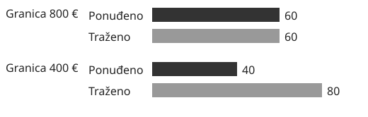



::: {.content-visible when-format="html"}
::: {.widget-frame data-naslov="Ograničenje najamnine" data-oznaka="02.1 · interaktivno"}
::: {.econ-controls}
<label for="granica">Gornja granica mjesečne najamnine (€)</label>
<input id="granica" type="range" min="200" max="900" step="50" value="400">
<output id="ishod" for="granica" aria-live="polite"></output>
<svg viewBox="0 0 360 110" style="max-width:32rem;width:100%" role="img" aria-label="Usporedba ponuđene i tražene količine stanova"><text x="5" y="32">Ponuđeno</text><rect id="ponuda" x="100" y="15" height="23" fill="#226657"/><text x="5" y="76">Traženo</text><rect id="potraznja" x="100" y="59" height="23" fill="#94521e"/></svg>

```{=html}
<script>
const cap = document.getElementById('granica');
function prikazi() {
  const cijena = Math.min(Number(cap.value), 600);
  const ponuda = cijena / 10;
  const potraznja = 120 - ponuda;
  document.getElementById('ponuda').setAttribute('width', 2.4 * ponuda);
  document.getElementById('potraznja').setAttribute('width', 2.4 * potraznja);
  document.getElementById('ishod').textContent = 'Granica ' + cap.value + ' €, najamnina ' + cijena + ' €, ponuđeno ' + ponuda + ', traženo ' + potraznja + ', manjak ' + (potraznja - ponuda) + '.';
}
cap.addEventListener('input', prikazi);
prikazi();
</script>
```
:::
:::
:::

::: {.content-visible when-format="typst"}

:::
